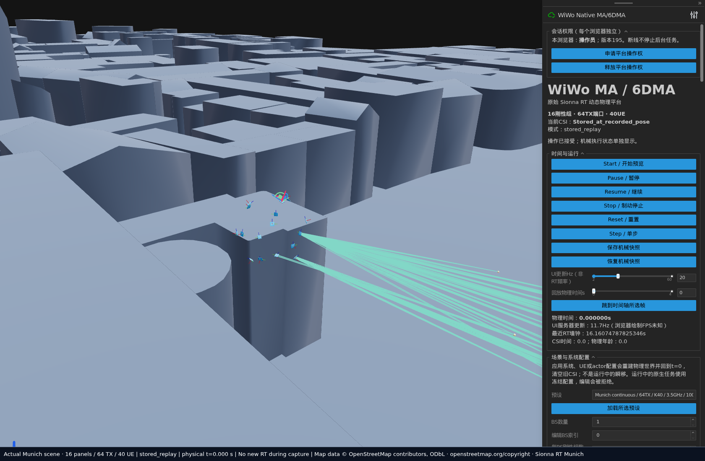
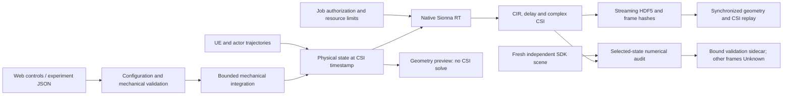
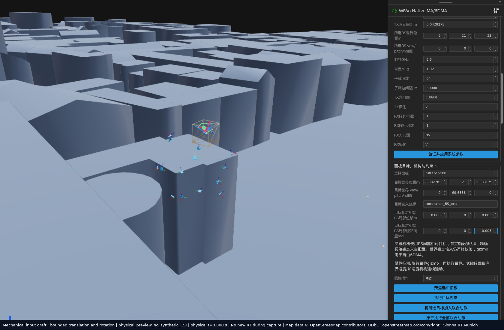
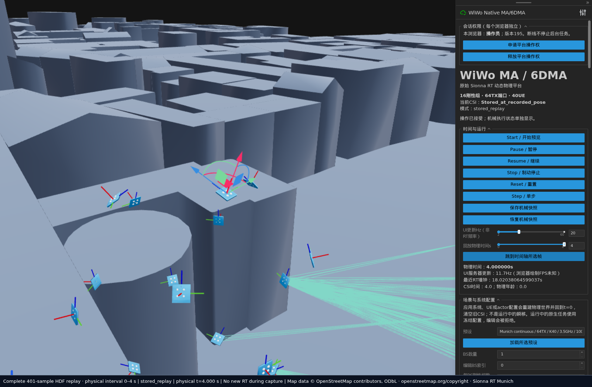

# WiWo-MA

### A Physics-Grounded Interactive Simulation Platform for Movable Antenna Systems

Configure a movable antenna system, execute bounded mechanical actions, compute
native Sionna RT channels, and replay complex CSI alongside the geometry that
produced it. WiWo-MA connects physical antenna ports, UE motion and dynamic
scene objects on a shared simulation timeline.



*Actual platform capture. Munich scene data: © OpenStreetMap contributors,
[ODbL](https://www.openstreetmap.org/copyright), supplied through Sionna RT.
Screenshots show mechanical preview or recorded native CSI, as labelled.*

> **Version 1.0.0 · MIT licensed.** The validated scope is documented below.
> Numerical SDK agreement does not certify every configuration or establish
> measurement-based physical truth. See [release scope](docs/release/STATUS.md).

## What the platform provides

- **Bounded MA/6DMA mechanics.** Fixed arrays, rail-mounted MAs, rigid panels
  and independently controlled panels, with translation/rotation constraints,
  workspace limits, velocity/acceleration limits and collision checks.
- **Native physical-port ray tracing.** Sionna RT 2.2.0 with
  `synthetic_array=False`, explicit spatial/polarization port mapping, complex
  CIR/CSI and heterogeneous receive-port masks.
- **Dynamic experiments.** Continuous UE and actor trajectories, moving
  antenna panels, and actual scene geometry for LOS/NLOS transitions.
- **Durable datasets.** Streaming HDF5, row hashes, frozen configurations,
  independent validation sidecars, bounded background jobs and frame-level
  recovery.
- **Interactive inspection.** Browser controls, recorded paths, CSI amplitude
  and phase, channel gain, time–frequency analysis and synchronized replay.

## Architecture and timing



The mechanical integration clock, action clock, CSI sampling clock, browser
refresh rate and solver wall time are distinct. The validated continuous
example uses 2 ms mechanics, 100 ms controls and 10 ms CSI sampling.
**Native RT is asynchronous and may take seconds per query.** Geometry preview
does not calculate CSI; HDF5 replay reads previously calculated samples.

## Installation

The tested platform is Linux with Python 3.11. Native GPU computation also
requires a compatible NVIDIA driver and OptiX. CPU mechanics, HDF5 reading and
Web replay do not require a GPU. Built-in scenes are installed with Sionna RT;
city meshes and dependency source trees are not vendored in this repository.

```bash
git clone https://github.com/ReamonYim/WiWo-MA.git
cd WiWo-MA
python3.11 -m venv .venv
source .venv/bin/activate
python -m pip install -e '.[test]'
python -m pip check
WIWO_GPU=-1 scripts/platform/run doctor
```

The numerical environment is pinned to Sionna RT 2.2.0, Mitsuba 3.9.1,
Dr.Jit 1.5.0 and Viser 1.1.1. Source-tree editable installation is the supported
deployment form. See [installation and OptiX](docs/installation.md).

## Quick start

### 1. Move a single MA — no GPU

```bash
python examples/01_single_ma.py --headless
WIWO_GPU=-1 python examples/01_single_ma.py --port 8080
```

Open `http://127.0.0.1:8080`. For SSH, forward both 8080 and the adjacent API
port 8081. Click **Start / 开始预览** to execute the predefined bounded motion.
Select a panel, edit its permitted target, then click **执行目标姿态** to submit
it. Check the submitted payload and execution status; editing a field alone
does not submit an action. Identical reached targets are explicitly labelled
as no-ops. See the [UI guide](docs/ui.md).

### 2. Preview the full dynamic 6DMA system — no GPU

```bash
python examples/02_dynamic_6dma.py --headless
WIWO_GPU=-1 python examples/02_dynamic_6dma.py --port 8080
```

This uses the qualified four-second trajectory: 16 panels, 64 spatial TX
ports, 40 UEs and two dynamic actors. The headless example traverses all 401
sampling states; the browser shows the actual mechanics. Neither command
generates CSI.



### 3. Read, analyze and replay a closed CSI dataset — no new RT

Datasets are separate from Git. Supply a compatible closed HDF5 that you are
authorized to use; [the data catalog](data/README.md) lists the frozen examples
and their verification scope. No unverified download link is supplied.

```bash
python examples/03_read_and_replay.py --dataset data/demo401/csi.h5 --time 2.01
python examples/03_read_and_replay.py --dataset data/demo401/csi.h5 \
  --plot artifacts/analysis/ue0.png
WIWO_GPU=-1 python examples/03_read_and_replay.py \
  --dataset data/demo401/csi.h5 --web --port 8080
```

Playback, pause, frame stepping and timeline scrubbing use the recorded
physical timestamps. Antenna coordinates, UE/actor geometry and CSI are read
from the same HDF5 row. See [data format and replay](docs/data.md).



The [complete gallery](docs/media/README.md) also includes the physical array,
actual actor occlusion, port-wise CSI and a recorded native-CSI time–frequency plot.

## Configure an experiment

The Web forms or experiment JSON define BS/UE counts and poses, panel arrays,
polarization, mechanical freedoms and limits, actor geometry and trajectories,
carrier frequency, subcarriers, propagation settings and simulation clocks.
Fixed, rail, Cartesian, gimbal and gantry–gimbal mechanisms have different
permitted freedoms; a rigid panel preserves its element coordinates.

For multiple panels, select each panel, enter its target, add it to the joint
action queue, then submit the complete transaction. Inputs are validated before
mechanical execution. Running frozen jobs cannot be silently reconfigured.
See [mechanics](docs/mechanics.md) and [configuration coverage](docs/validation.md).

## Generate native CSI — explicit GPU authorization required

Preparing or previewing an experiment does not authorize device computation.
The generic job workflow freezes the configuration and execution source before
launch, checks a job-specific resource grant, and retains progress and failure
records. It never borrows a historical experiment's remaining budget.

```bash
# CPU planning/admission only; use a new output directory.
WIWO_GPU=-1 scripts/platform/run plan --config configs/platform/single_ma_bounded.json \
  --job artifacts/platform/jobs/my_sequence --max-wall-s 300 --max-disk-gib 1

# Only after the resource owner approves this exact job and grant.
scripts/platform/run launch --job artifacts/platform/jobs/my_sequence \
  --authorization artifacts/approvals/my_sequence.json

# Explicit recovery retains committed frames and uses the same approved scope.
scripts/platform/run launch --job artifacts/platform/jobs/my_sequence \
  --authorization artifacts/approvals/my_sequence.json --resume
```

No approved GPU grant is shipped. A complete Full64 trajectory can take hours;
do not infer cost from UI rendering speed. The [GPU workflow guide](docs/gpu-jobs.md)
explains resource estimates, OptiX, authorization and recovery.

## Validation and scope

Frozen v1.0.0 evidence includes a native 16-panel/64TX/40UE four-second,
401-frame sequence, cross-process recovery after frame 201, complete replay,
and selected independent SDK comparisons. The original numerical gate is
per-UE NMSE ≤ 10⁻³, including weak users.

| Frozen evidence | Independently checked | Still Unknown |
|---|---:|---:|
| Full-scale 4 s / 401 frames | 20 | 381 |
| Small-scale 4 s / 401 frames | 9 | 392 |
| Original 30 s / 3001 frames | 24 | 2977 |
| Additional selected pose/path gate | 8 CSI + 8 complete-path states | No inference to other states |

The full-scale selected comparisons reached worst per-UE NMSE
6.4625×10⁻¹⁵. The additional gate includes 736 valid polarized path terms and
same-time mechanical intervention/control comparisons. These are **SDK
numerical consistency results, not measurement-based physical validation**.
Packaging preserves the frozen propagation core; this public candidate does
not claim a new GPU campaign. Details and untested configurations are in the
[validation matrix](docs/validation.md).

```bash
CUDA_VISIBLE_DEVICES='' WIWO_GPU=-1 python -m pytest tests/platform -q
python -m ruff check src tests examples scripts
python -m compileall -q src examples scripts
```

Public CPU tests are separate from `tests/restricted`, which requires retained
research artifacts. GitHub Actions performs CPU installation, import/static
checks, mechanics/storage tests and source-bundle checks. Consult the actual
repository Actions results; local checks are not a hosted CI badge.

## Limitations

- Only the listed configurations, motions and sampled states are validated.
  Arbitrary array sizes, mechanisms, action histories and materials are not
  all certified.
- Ideal rigid mechanics and SDK antenna patterns do not model mutual
  coupling, detailed support structures or arbitrary robot joint kinematics.
- 100 Hz sampling is not a universal Doppler guarantee. Occlusion and path
  birth/death need not be band-limited; the platform does not interpolate fake
  Full RT labels.
- The original 30-second sequence retains its trajectory reversal, mirrored
  revisit/leakage risk, 29 unattributed low-correlation events and short-segment
  SDK offset limitations.
- New-machine CUDA/OptiX compatibility and untested browsers remain Unknown.
  The Web service targets trusted local/SSH research use, not public multi-tenant hosting.

## Citation, acknowledgments and license

See [citation instructions](CITATION.md). Formal author metadata and any paper
or DOI remain unspecified; no affiliation or institutional endorsement is invented.

WiWo-MA uses [Sionna RT](https://nvlabs.github.io/sionna/rt/),
[Mitsuba](https://www.mitsuba-renderer.org/),
[Dr.Jit](https://github.com/mitsuba-renderer/drjit),
[Viser](https://github.com/viser-project/viser) and the scientific Python
ecosystem. Munich scene data originate from OpenStreetMap and retain their
[ODbL attribution requirements](https://www.openstreetmap.org/copyright).
See [third-party notices](THIRD_PARTY_NOTICES.md).

**Project code is released under the [MIT license](LICENSE).** You may use,
modify and redistribute it, including commercially, while retaining the
copyright and license notice. Scene data and dependencies retain their own
terms. See [contributing](CONTRIBUTING.md),
[security](SECURITY.md) and the [release checklist](docs/release/PUBLISHING.md).
