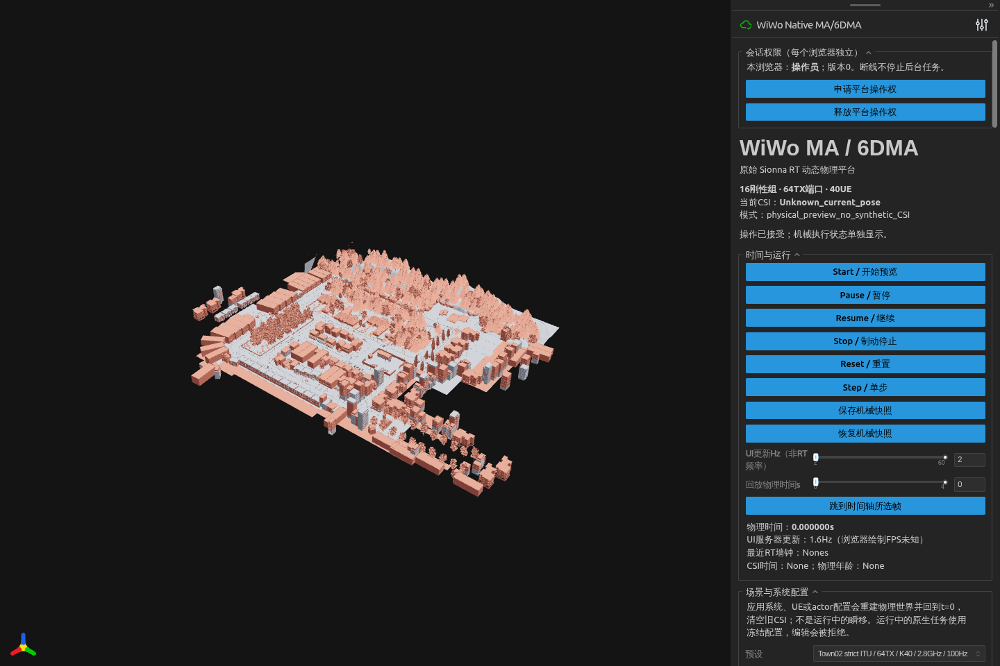
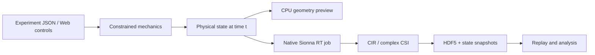
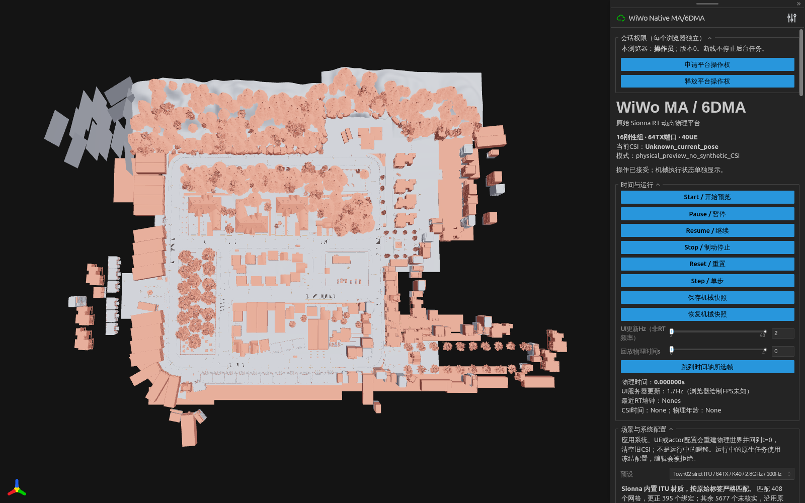
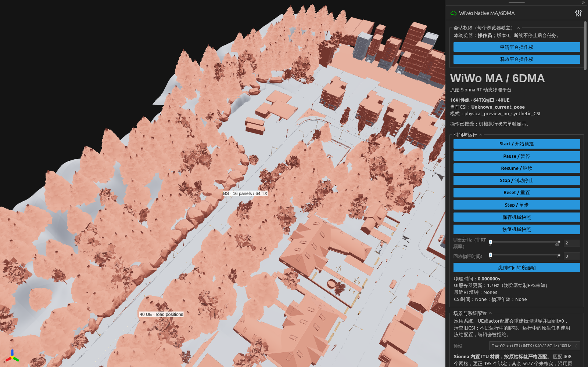
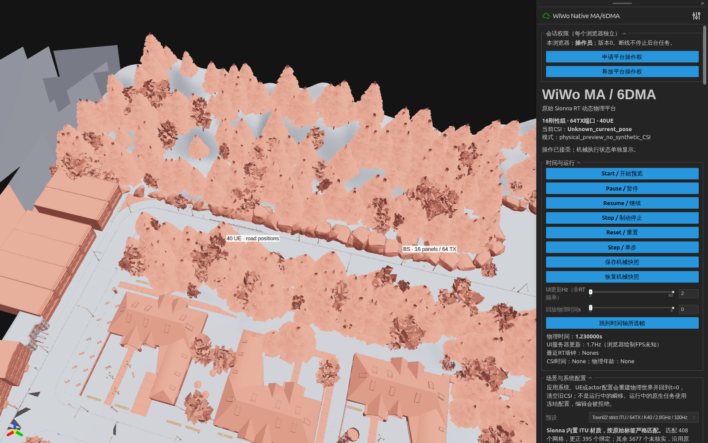
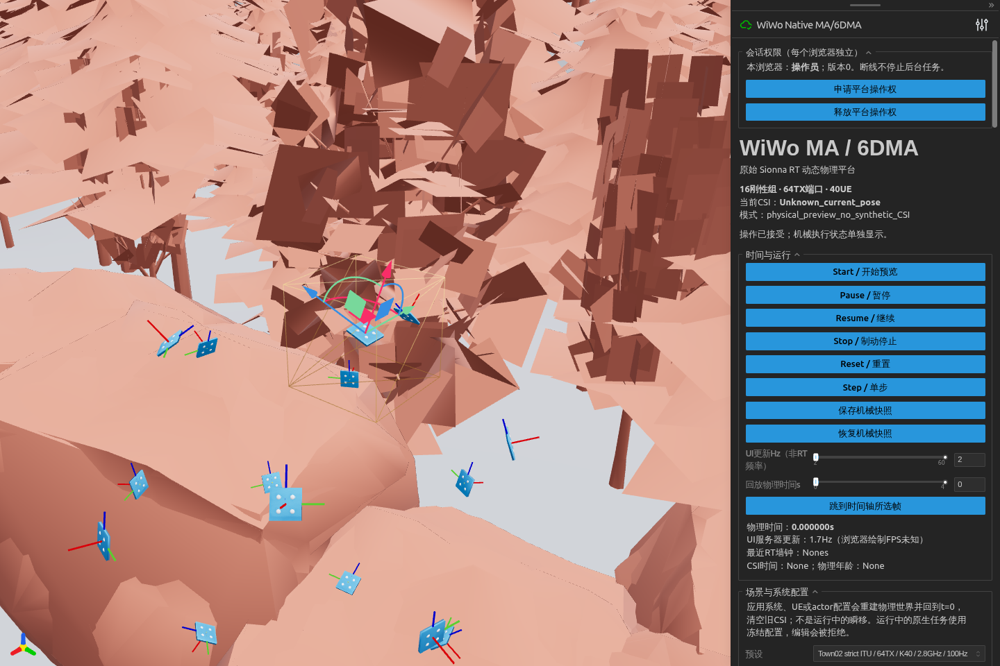
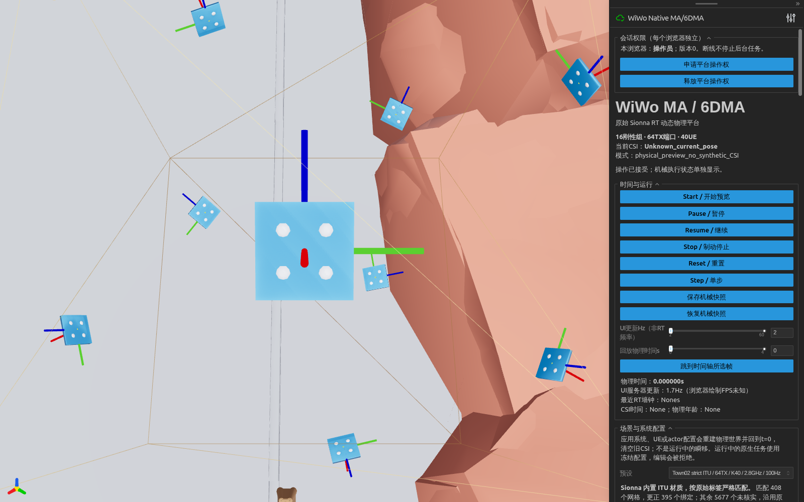

# WiWo-MA

**A research platform for movable antennas and 6DMA systems, built on Sionna RT.**

WiWo-MA connects antenna motion, scene geometry and channel measurements on the same simulation timeline. You can arrange physical antenna ports, move panels within mechanical limits, run native ray-tracing jobs, and inspect saved complex CSI alongside the state that produced it.

The current examples use **Town02: 16 panels, 64 physical TX ports, 40 UEs, and a 2.8 GHz carrier**. The browser preview runs on the CPU. Computing new channels requires a working NVIDIA/CUDA/OptiX environment and a separately authorized job.



*Town02 in the running platform. The camera frames the full scene; the screenshots below show the street layout, base-station neighborhood and movable antennas at closer distances.*

## 🧭 What the platform does

- **MA and 6DMA mechanics.** Fixed arrays, rail-mounted antennas, Cartesian stages, gimbals and independently controlled panels. Workspace, velocity and acceleration limits are checked before motion is applied.
- **Physical array geometry.** Element positions follow the panel pose. Sionna queries use explicit spatial ports with `synthetic_array=False`, including the configured polarization mapping.
- **Dynamic scenes.** Antenna panels, UEs and optional actors share physical timestamps. The display refresh rate, mechanical integration step and channel sampling interval are separate settings.
- **Native channel generation.** Sionna RT produces paths, CIR and complex CSI at the actual system state. The platform does not fill preview frames with approximate or invented channel values.
- **Reproducible experiments.** JSON configurations, state snapshots, streaming HDF5 output, frame hashes, interrupted-job recovery and selected independent SDK comparisons.
- **Inspection and replay.** Preview motion, inspect individual ports, step through recorded frames, and plot saved channel amplitude, phase and time–frequency behavior.



## 🚀 Set up the platform

Use Linux, Git and Python 3.11 or newer. The tested numerical environment pins Sionna RT 2.2.0, Mitsuba 3.9.1, Dr.Jit 1.5.0 and Viser 1.1.1. An editable source installation keeps the code, configurations and project assets together.

```bash
git clone https://github.com/ReamonYim/WiWo-MA.git
cd WiWo-MA
python3.11 -m venv .venv-full
.venv-full/bin/python -m pip install -e '.[test]'
.venv-full/bin/python -m pip check
WIWO_PYTHON=.venv-full/bin/python scripts/platform/run doctor
```

You can try the small project-owned reflector scene before obtaining any city map:

```bash
WIWO_PYTHON=.venv-full/bin/python scripts/platform/run serve \
  --config configs/platform/reflector.json --port 8080
```

Open `http://localhost:8080` on the server, or forward the Web port to your computer as described below. Stop this foreground preview with Ctrl+C before starting another service on the same port.

The installer can also prepare the environment and run the CPU checks:

```bash
scripts/platform/install --no-town02 --no-browser
```

`--no-town02` leaves external map import for later. `--no-browser` skips server-side Chromium, which is only needed for browser automation and screenshots. A browser on your own computer is sufficient for normal Web use. The installer can use an existing Conda installation to prepare a compatible Python environment. See [installation details](docs/installation.md).

## 🏙️ Load Town02

Town02 is an **external scene**, not a required download for the whole platform. Its XML, PLY meshes and CSV positions are required when you select a Town02 configuration. They are not included in Git or the source archive. Obtain the complete `Sionna_Town02` package from its original provider or use your existing authorized copy; this repository does not publish a separate download URL for it.

```text
Sionna_Town02/
├── <original checksum manifest>
└── Town2_xml/
    ├── town2_xml.xml
    ├── town2_3mat.xml
    ├── meshes/
    ├── car_coordinate/
    └── material_manager.py
```

Keep the checksum manifest under the filename supplied by the resource provider;
the [resource guide](assets/README.md) explains the import requirements.
With the dependencies installed:

```bash
.venv-full/bin/python -m wiwo_ma.platform.town02 import --source /path/to/Sionna_Town02
.venv-full/bin/python -m wiwo_ma.platform.town02 status --require
.venv-full/bin/python -m wiwo_ma.platform.town02_materials check
```

The source can also be selected through `WIWO_TOWN02_SOURCE`; its default is `$HOME/project/Sionna_Town02`. For a full installation and import in one command:

```bash
WIWO_TOWN02_SOURCE=/path/to/Sionna_Town02 scripts/platform/install --no-browser
```

The importer checks source hashes before changing an existing import, copies resources into `assets/town02/`, and generates the strict material variant and its audit. It preserves the original scene and coordinates. The full map has **6,085 meshes, 2,831,119 vertices and 3,268,710 triangles**. The imported resource set contains 8,635 files, about 144 MiB uncompressed.



*A near-vertical view makes the road network and city blocks easier to read. Use **Map overview** to frame the map in your own session. A separate [geometry projection](docs/media/town02-map-overview.png) shows the material groups and UE layout.*



*The blocks around the actual base station. The label marks its world position; the scene and radio-material bindings are the same as in the full overview.*

### Materials and provenance

The original radio scene groups objects into brick, concrete and wood. The strict variant also uses Sionna's built-in glass and metal models. Assignment follows **exact original material IDs**, recovered through matching mesh filenames. Color, generic object names and optical PBR parameters are not used to guess RF materials.

| ITU model | Original mesh bindings | Current mesh bindings |
|---|---:|---:|
| `brick` | 4,920 | 4,601 |
| `concrete` | 614 | 753 |
| `wood` | 551 | 575 |
| `glass` | 0 | 91 |
| `metal` | 0 | 65 |

The 21 approved source-ID rules match 408 meshes and correct 395 bindings. **The other 5,677 meshes retain their old bindings and remain physically unverified.** The table describes assigned models, not measured composition.

Permittivity and conductivity come from the pinned Sionna ITU models at the configured frequency. SDK defaults for thickness and scattering are retained. Frequency bands, source hashes, geometry and per-mesh bindings are checked; no global material override is applied.

The public [assignment rules](configs/materials/town02_strict_itu.json) and [resource guide](assets/README.md) explain the boundary between source code and external data. Import creates `assets/town02/town2_strict_itu.materials.json` with the per-mesh evidence. The original three-material scene remains available.

## Open the Web interface

For a persistent Town02 preview:

```bash
scripts/platform/town02-service restart
scripts/platform/town02-service status
```

`"status": "ready"` means the expected Web/API ports are owned by the managed process, the current strict preset is loaded, and the first map draw has completed. Closing the terminal does not stop the service. Logs are in `.state/town02-service/8080/`; use `scripts/platform/town02-service stop` to stop that process.

- **Local machine:** open `http://localhost:8080`.
- **VS Code Remote SSH:** this project includes automatic forwarding for 8080 and 8081. If it is not detected, press F1, run **Forward a Port**, add both ports, and use **Open in Browser** for 8080. Keep the remote connection open. If the local port is occupied, use the address shown in the Ports panel.
- **Hosted container:** use the address supplied by your platform's port mapping for 8080.

The background manager listens on `0.0.0.0` by default. Use `restart --host 127.0.0.1` for a loopback-only service. Container restart persistence belongs in the platform's startup settings; a detached process does not survive a container restart.



*The experiment in its surroundings, after the scheduled antenna motion. The labels identify the real BS and UE positions. Preview, mechanical time and CSI status are shown by the application.*

## 🦾 Run a mechanical experiment



*The 16-panel apparatus before motion, with four physical TX ports per panel. The capture checks displayed TX coordinates against the physical state, then executes and verifies the scheduled motion.*



*A closer view of the selected panel and its four ports. The camera faces the actual panel normal, so its surface and element layout are visible.*

Choose a preset, then use **Start**, **Pause**, **Step** and **Reset** to inspect the motion. To submit a manual target:

1. Select a panel and choose world coordinates or the constrained BS-local input mode.
2. Enter a permitted position and rotation, or adjust the target gizmo.
3. Use the target-pose execution button to submit it. Editing a field alone does not move the antenna.
4. Check the submitted action and its execution status. For several panels, add targets to the joint action queue and submit the transaction.

| Configuration | System | Physical interval |
|---|---|---|
| [`town02_strict_itu_single_ma.json`](configs/platform/town02_strict_itu_single_ma.json) | One rail-mounted MA, one UE | 1 s |
| [`town02_strict_itu_64tx_40ue.json`](configs/platform/town02_strict_itu_64tx_40ue.json) | 16 panels, 64 TX ports, 40 UEs | 4 s / 401 samples |
| [`reflector.json`](configs/platform/reflector.json) | Small included scene for setup and development | Configured in JSON |

```bash
WIWO_GPU=-1 .venv-full/bin/python examples/01_single_ma.py --headless
WIWO_GPU=-1 .venv-full/bin/python examples/02_dynamic_6dma.py --headless
```

These traverse actual mechanical states without ray tracing. Town02 UE positions are anchored to archived road coordinates and use new bounded trajectories; they are not playback of the recorded cars. Cars already in the map remain static geometry. See [mechanics](docs/mechanics.md), [UI controls](docs/ui.md) and [Town02 coordinates](docs/town02.md).

## 📡 Generate and analyze channels

The Web preview does not continuously run the native solver. A channel job freezes its configuration and physical state, checks the resource grant, and stores results with timestamps and geometry. Start with a small case and confirm CUDA/OptiX compatibility before planning a full multi-port sequence.

```bash
# CPU planning only; choose a fresh job directory.
WIWO_PYTHON=.venv-full/bin/python WIWO_GPU=-1 scripts/platform/run plan \
  --config configs/platform/town02_strict_itu_single_ma.json \
  --job artifacts/jobs/town02-single --max-wall-s 300 --max-disk-gib 1

# After preparing a job-specific resource grant:
WIWO_PYTHON=.venv-full/bin/python WIWO_GPU=0 scripts/platform/run launch \
  --job artifacts/jobs/town02-single \
  --authorization artifacts/approvals/town02-single.json
```

No approved grant is shipped. The [GPU workflow](docs/gpu-jobs.md) covers driver/OptiX setup, estimates, grant fields, bounded background execution and recovery. The same prepared job can be resumed with `--resume` within its approved scope.

A completed native dataset can be read or replayed without a new solve:

```bash
.venv-full/bin/python examples/03_read_and_replay.py \
  --dataset artifacts/jobs/town02-single/csi.h5 --time 0.5
.venv-full/bin/python examples/03_read_and_replay.py \
  --dataset artifacts/jobs/town02-single/csi.h5 --web --port 8080
```

Use the recorded scene for replay. A Munich dataset does not become Town02 CSI by changing a map setting. Dataset axes, timestamps and validation sidecars are described in the [data guide](docs/data.md).

## Tests and validation

```bash
# Self-contained CPU tests, including generated XML/PLY fixtures:
.venv-full/bin/python -m pytest tests/platform -m 'not town02' -q

# Full Town02 integration; a missing or incomplete import is an error:
.venv-full/bin/python -m pytest tests/platform -m town02 --require-town02 -q

# Runtime checks, the complete CPU suite and both mechanical examples:
scripts/platform/check --require-town02
```

A clean checkout can run the platform tests without the external map. Tests marked `town02` check actual XMLs, the import manifest, referenced meshes and generated strict resources before running. They are skipped only when the import is entirely absent and was not explicitly required. A partial import fails instead of being silently skipped. All real-scene material and geometry assertions remain enabled when the resources are present.

Public CI exercises the importer, strict material rules, real PLY loading and mechanics with 25 independently authored quadrilaterals. It does not substitute those shapes for Town02 in the viewer or claim that they validate full city propagation.

CPU preview and screenshot capture do not establish native Town02 CSI accuracy or certify a machine's GPU runtime. Historical Munich selected-state SDK comparisons are documented separately in the [platform workflow](docs/platform-overview.md) and [validation matrix](docs/validation.md).

## Capture the running Town02 interface

```bash
.venv-full/bin/python scripts/media/capture_town02.py
```

Run this from a terminal that can listen on local ports and launch the installed Playwright Chromium. It selects a fresh private port pair, starts the production CPU-preview UI at 2 Hz, captures the panorama, antenna panels and full frontend, checks that the scheduled antenna motion actually occurs, and closes the temporary service. An existing 8080 service is left unchanged. Private screenshot services are excluded from VS Code automatic port forwarding.

Successful capture writes six PNGs and `town02-gallery.json` into `docs/media/`; see the [image index](docs/media/README.md). The [capture record](docs/media/town02-gallery.json) contains the strict scene configuration, camera positions, image hashes, physical timestamps and verified motion. These are actual browser screenshots, captured with Chromium and software WebGL; they do not use historical Munich data or compute CSI.

## Documentation and license

[Town02 resources](assets/README.md) · [Installation](docs/installation.md) · [UI guide](docs/ui.md) · [Mechanics](docs/mechanics.md) · [GPU jobs](docs/gpu-jobs.md) · [Data and replay](docs/data.md) · [Screenshot provenance](docs/media/town02-gallery.json)

Project-owned source code and the small reflector scene are [MIT licensed](LICENSE). Sionna, other dependencies and externally supplied scenes retain their own terms; see [third-party notices](THIRD_PARTY_NOTICES.md) and [citation information](CITATION.md).
