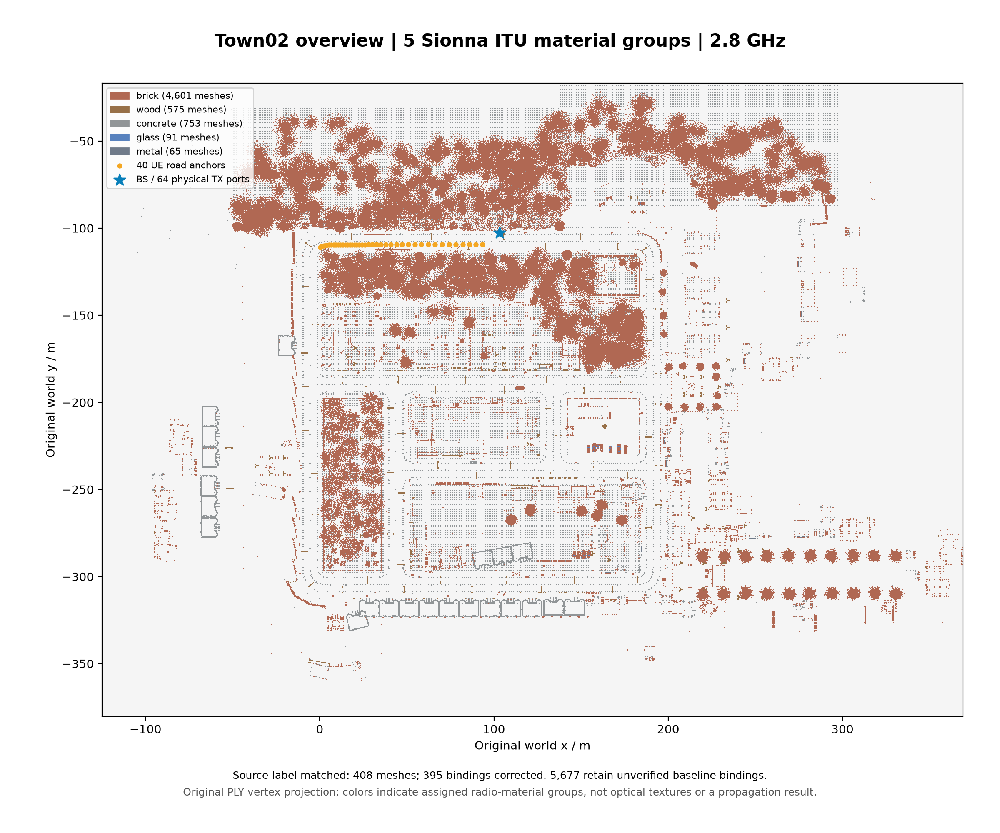

# WiWo-MA · Town02 地图加载与可移动天线仿真

在 WiWo-MA 中加载 `Sionna_Town02` 地图，保留原始世界坐标，显示基站、可移动天线面板和 UE，
并使用 **Sionna RT 2.2.0 内置 ITU 无线材质**。默认场景为 **16 个面板、64 个物理 TX 端口、40 个 UE、2.8 GHz**。



*由本地 Town02 原始 PLY 顶点生成的俯视投影。颜色表示无线材质绑定，星号为基站，橙点为 UE 初始位置；不是光学贴图或射线追踪结果。*

## 1. 下载代码，准备地图资源

```bash
git clone https://github.com/ReamonYim/WiWo-MA.git
cd WiWo-MA
```

**原始地图资源需要单独准备，不包含在 Git 仓库中。** 使用你已有的 `Sionna_Town02` 资源包，目录应包含：

```text
Sionna_Town02/
├── 资源SHA256.json
└── Town2_xml/
    ├── town2_xml.xml           # 原始材质标签
    ├── town2_3mat.xml          # 原三材质无线场景
    ├── meshes/                # 原始 PLY 网格
    ├── car_coordinate/        # 归档车辆坐标 CSV
    └── material_manager.py
```

导入器复制完整资源并检查 SHA-256，不修改源目录。导入后的主场景有 **6,085 个网格、2,831,119 个顶点、3,268,710 个三角形**。
原始地图不缩放、不平移。资源准备、坐标来源和验证范围见 [Town02 指南](docs/town02.md)。

## 2. 安装依赖并导入地图

使用 Linux、Git 和 Python 3.11 及以上版本；安装器也支持通过已有 Conda 创建项目内 Python 环境。
将下面的路径替换成资源包的实际位置：

```bash
WIWO_TOWN02_SOURCE=/path/to/Sionna_Town02 scripts/platform/install
```

默认资源路径为 `$HOME/project/Sionna_Town02`。安装器会创建独立的 `.venv-full`，安装依赖，
复制地图，生成保守材质版本，运行 CPU 检查，并安装用于自动化检查的 Chromium。
Ubuntu 20.04 会使用兼容的 Playwright 额外依赖。详见[安装说明](docs/installation.md)。

已安装依赖、只需重新导入资源时：

```bash
.venv-full/bin/python -m wiwo_ma.platform.town02 import --source /path/to/Sionna_Town02
.venv-full/bin/python -m wiwo_ma.platform.town02_materials check
```

## 3. 启动网页，查看地图

```bash
scripts/platform/town02-service restart
```

显示 `"status": "ready"` 表示网页和 API 已可访问、地图完成首次绘制，且使用当前保守材质配置。
后台服务默认监听 **8080**，API 使用 **8081**；退出终端不会停止网页进程。

- **在服务器本机访问：** 打开 <http://localhost:8080>。
- **通过 VS Code 远程 SSH 访问：** 项目已提供自动转发 8080 / 8081 的设置。
  若未自动转发，按 F1，运行 `Forward a Port`，分别添加两个端口，再在“端口”面板点击 8080 的“在浏览器中打开”。
  保持远程连接；本地端口冲突时，以面板显示的地址为准。
- **通过服务器平台的端口映射访问：** 使用平台为 8080 生成的网页地址。

```bash
scripts/platform/town02-service status   # 检查状态
scripts/platform/town02-service stop     # 停止自己管理的网页进程
```

日志保存在 `.state/town02-service/8080/`。前台启动可用 `scripts/platform/town02 --port 8080`。
容器重启后需再次启动服务，或在运行平台配置启动命令；后台进程本身不提供容器开机自启。

## 4. 材质如何设置

原场景只有砖、混凝土、木材三类无线材质。当前默认版本扩展为 **五类**，只按原始 XML 中明确的材质 ID 精确匹配，
不根据颜色、物体类别或光学 PBR 数值猜测电磁材质。

| Sionna ITU 类型 | 原三材质版本：绑定网格数 | 当前版本：绑定网格数 |
| --- | ---: | ---: |
| 砖 `brick` | 4,920 | 4,601 |
| 混凝土 `concrete` | 614 | 753 |
| 木材 `wood` | 551 | 575 |
| 玻璃 `glass` | 0 | 91 |
| 金属 `metal` | 0 | 65 |
| **合计** | **6,085** | **6,085** |

**21 条精确 ID 规则匹配了 408 个网格，其中更正了 395 个绑定。** 其余 **5,677 个网格保留旧绑定，物理材质仍未核实**。
上述数量是分配结果，不代表整张地图的真实成分已经确认；原始标签也不是实测成分证明。

相对介电常数和电导率由 Sionna 内置模型按载频提供，不手填系数。厚度和散射等保留 SDK 默认值；
不应用全局材质覆盖。修改载频时会检查内置模型的有效频段。

规则见 [`configs/materials/town02_strict_itu.json`](configs/materials/town02_strict_itu.json)。
每个网格的来源、绑定更改和依据在导入后生成的 `assets/town02/town2_strict_itu.materials.json` 中记录。
原三材质 XML 与配置继续保留。

## 配置与检查

| 配置 | 用途 |
| --- | --- |
| [`town02_strict_itu_single_ma.json`](configs/platform/town02_strict_itu_single_ma.json) | 单 MA / 单 UE，1 秒机械示例 |
| [`town02_strict_itu_64tx_40ue.json`](configs/platform/town02_strict_itu_64tx_40ue.json) | 默认 16 面板 / 64TX / 40UE，4 秒、401 个采样时刻 |
| [`town02_64tx_40ue.json`](configs/platform/town02_64tx_40ue.json) | 保留原三材质的对照配置 |

UE 初始位置来自归档道路坐标，使用新定义的有界运动；不是原车辆轨迹回放。原地图中的车辆是静态网格。

```bash
scripts/platform/check
WIWO_GPU=-1 .venv-full/bin/python examples/01_single_ma.py --headless
WIWO_GPU=-1 .venv-full/bin/python examples/02_dynamic_6dma.py --headless
.venv-full/bin/python scripts/platform/map_overview.py --output artifacts/town02/map-overview.png
```

这些检查与网页预览验证资源、材质分配和机械运动，**不计算 CSI**。
Town02 的原生 SDK 场景加载、CUDA / OptiX 和 GPU 传播结果仍需独立验证。
原 Munich 数据的数值结论不用于证明 Town02 的传播正确性。

## 其他文档

- [Town02 资源、坐标和材质说明](docs/town02.md)
- [安装与浏览器依赖](docs/installation.md)
- [界面操作](docs/ui.md) · [机械模型](docs/mechanics.md)
- [原平台与 Munich / CSI 工作流](docs/platform-overview.md)
- [原生 GPU 计算](docs/gpu-jobs.md) · [数据与回放](docs/data.md)

项目代码使用 [MIT 许可证](LICENSE)。Town02 原始资源、依赖和历史场景保留各自的权利与使用条件，
见[第三方说明](THIRD_PARTY_NOTICES.md)。
